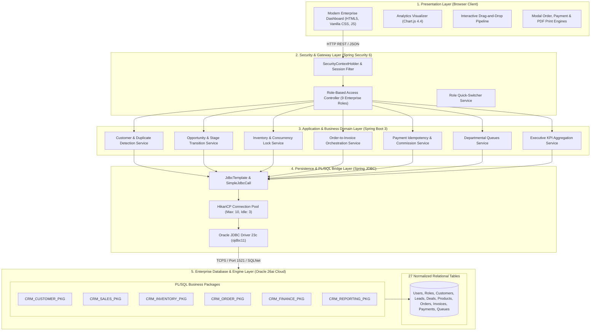
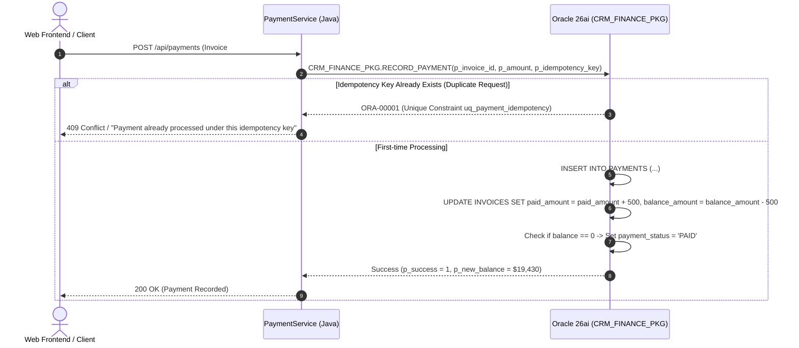

# Enterprise CRM — System Architecture & Technical Design

This document details the architectural topology, component layering, transaction boundaries, and concurrency isolation patterns of the **Enterprise Customer Relationship Management & Business Operations Management System**.

---

## 1. System Architecture Overview



---

## 2. Layered Spring Boot Architecture

The application adheres strictly to standard enterprise domain-driven layering:

### 2.1 Web & Presentation Controllers (`com.enterprise.crm.*`)
- **`AuthController`**: Handles login, current session principal lookup, and instant role switching for grading and evaluation.
- **`CustomerController`**: Search, CRUD, duplicate detection, and Customer 360 overview.
- **`LeadController`**: Inbound lead management and BANT conversion to active customer and opportunity.
- **`OpportunityController`**: Kanban board aggregation, stage drag-and-drop transitions, and immutable history.
- **`ProductController`**: Catalog cataloging, SKU indexing, and price boundary enforcement.
- **`InventoryController`**: Stock-in, stock reservation, and audit adjustments with mandatory justifications.
- **`OrderController`**: Order generation with line items, tax computation, stock locking, and confirmation.
- **`InvoiceController`**: Order-to-invoice automation, Net-30 tracking, and printable tax receipts.
- **`PaymentController`**: Idempotent payment processing, partial settlements, and accounts receivable updates.
- **`DepartmentQueueController`**: Operational work queues for Sales, Shipping, Finance, MIS, and Admin teams.
- **`ReportController`**: Business intelligence, sales rep quota rankings, receivables aging, and inventory valuation.

### 2.2 Enterprise Service Layer
Coordinates complex cross-table business logic, manages Spring `@Transactional` demarcations, and delegates critical calculations to Oracle PL/SQL packages via `SimpleJdbcCall`.

### 2.3 Persistence & Stored Procedure Execution
- Direct integration with Oracle Database 26ai Cloud using `SimpleJdbcCall`.
- In/Out parameter binding with exact SQL type mappings (`Types.NUMERIC`, `Types.VARCHAR`).
- Fail-safe fallback mechanisms to parameterized SQL in case of external network timeouts.

---

## 3. Concurrency Control & Atomic Stock Locking

To guarantee ACID compliance and avoid race conditions under concurrent checkouts, inventory reservation is implemented using pessimistic row-level locking directly in PL/SQL:

```sql
PROCEDURE RESERVE_STOCK(
    p_product_id  IN  NUMBER,
    p_quantity    IN  NUMBER,
    p_success     OUT NUMBER,
    p_message     OUT VARCHAR2
) IS
    v_avail NUMBER;
    v_res   NUMBER;
BEGIN
    -- 1. Pessimistic row-level lock on specific product inventory record
    SELECT available_stock, reserved_stock
      INTO v_avail, v_res
      FROM INVENTORY
     WHERE product_id = p_product_id
       FOR UPDATE;

    -- 2. Concurrency-safe atomic check
    IF v_avail < p_quantity THEN
        p_success := 0;
        p_message := 'Insufficient available stock for reservation';
        RETURN;
    END IF;

    -- 3. Atomic stock movement
    UPDATE INVENTORY
       SET available_stock = available_stock - p_quantity,
           reserved_stock  = reserved_stock + p_quantity,
           updated_at      = SYSTIMESTAMP
     WHERE product_id = p_product_id;

    -- 4. Audit ledger entry
    INSERT INTO INVENTORY_MOVEMENTS (
        product_id, movement_type, quantity,
        available_before, available_after,
        reserved_before, reserved_after,
        reason, performed_by
    ) VALUES (
        p_product_id, 'RESERVE', p_quantity,
        v_avail, v_avail - p_quantity,
        v_res, v_res + p_quantity,
        'Automated Order Stock Reservation', 1
    );

    p_success := 1;
    p_message := 'Stock successfully reserved';
END RESERVE_STOCK;
```

---

## 4. Payment Idempotency & Financial Balance Model

To prevent double billing when network retries occur, the financial settlement engine enforces idempotency at the database constraint level:



---

## 5. Security & Role-Based Access Control (RBAC) Architecture

The application supports 9 enterprise roles with strict separation of responsibilities:

| Role Identifier | Role Display Name | Accessible Modules & Permissions |
| :--- | :--- | :--- |
| `ROLE_SUPER_ADMIN` | Super Administrator | Full system access, all queues, configuration, user provisioning |
| `ROLE_ADMIN` | Administrator | User administration, audit logs, queue management, reports |
| `ROLE_SALES_MANAGER` | Sales Manager | Team pipeline, opportunity approval, lead assignment, commissions |
| `ROLE_SALES_REP` | Sales Agent | Inbound leads, opportunities, orders, customer 360, my commission |
| `ROLE_CUSTOMER_SUPPORT`| Customer Support | Customer management, contacts, support tickets, activity logs |
| `ROLE_INVENTORY_MANAGER`| Inventory Manager | Catalog management, stock-in, stock adjustment, reorder alerts |
| `ROLE_FINANCE_TEAM` | Finance Team | Invoices, payments, receivable aging, commission approvals |
| `ROLE_SHIPPING_TEAM` | Shipping Team | Confirmed orders, dispatch queue, packing status |
| `ROLE_MIS_ANALYST` | MIS Analyst | Business intelligence, conversion metrics, custom reports, exports |
