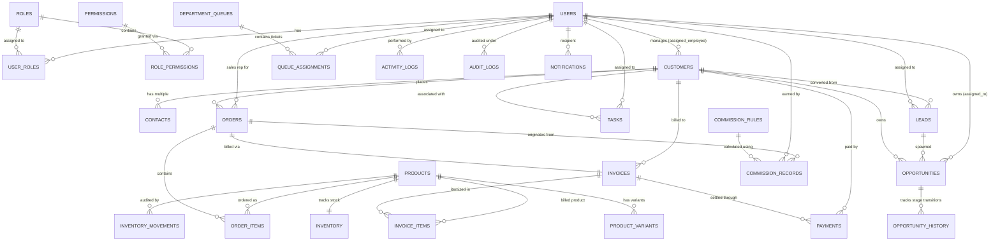

# Enterprise CRM — Entity-Relationship (ER) Diagram & Schema Specification

This document provides the complete Entity-Relationship architecture for the **Enterprise Customer Relationship Management (CRM) & Business Operations System**, deployed on **Oracle Database 26ai Cloud**.

---

## 1. High-Level Entity-Relationship Model (Mermaid Diagram)

---

## 2. Relational Schema Architecture & Data Dictionary

The Enterprise CRM database consists of **27 fully normalized tables** grouped into 7 functional domains:

### Domain 1: Identity & Role-Based Access Control (RBAC)

1. **`ROLES`**
   - `role_id` (NUMBER, PK, Identity): Unique role identifier.
   - `role_name` (VARCHAR2(50), UNIQUE): Normalized security role (`ROLE_SUPER_ADMIN`, `ROLE_ADMIN`, `ROLE_SALES_MANAGER`, `ROLE_SALES_REP`, `ROLE_CUSTOMER_SUPPORT`, `ROLE_INVENTORY_MANAGER`, `ROLE_FINANCE_TEAM`, `ROLE_SHIPPING_TEAM`, `ROLE_MIS_ANALYST`).
   - `display_name` (VARCHAR2(100)): Human-readable role label.
   - `description` (VARCHAR2(255)): Functional scope description.

2. **`PERMISSIONS`**
   - `permission_id` (NUMBER, PK, Identity): Unique permission identifier.
   - `permission_key` (VARCHAR2(80), UNIQUE): Security key (`CUSTOMER_CREATE`, `CUSTOMER_EDIT`, `INVOICE_APPROVE`, `COMMISSION_CALC`, `INVENTORY_ADJUST`).
   - `module` (VARCHAR2(50)): CRM subsystem classification.

3. **`USERS`**
   - `user_id` (NUMBER, PK, Identity): Unique employee identifier.
   - `username` (VARCHAR2(50), UNIQUE): Login handle.
   - `password_hash` (VARCHAR2(255)): Standard BCrypt salted password hash.
   - `full_name` (VARCHAR2(100)): Employee full name.
   - `email` (VARCHAR2(100), UNIQUE): Enterprise corporate email.
   - `phone` (VARCHAR2(30)): Direct contact line.
   - `department` (VARCHAR2(50)): Functional department.
   - `status` (VARCHAR2(20)): `ACTIVE`, `INACTIVE`, `SUSPENDED`.
   - `failed_login_attempts` (NUMBER): Brute-force throttling counter.
   - `locked_until` (TIMESTAMP): Account lockout expiration timestamp.

4. **`USER_ROLES`** (Junction Table)
   - `user_id` (FK -> USERS.user_id, Composite PK)
   - `role_id` (FK -> ROLES.role_id, Composite PK)

5. **`ROLE_PERMISSIONS`** (Junction Table)
   - `role_id` (FK -> ROLES.role_id, Composite PK)
   - `permission_id` (FK -> PERMISSIONS.permission_id, Composite PK)

---

### Domain 2: Customer Relationship Management & Leads

6. **`CUSTOMERS`**
   - `customer_id` (NUMBER, PK, Identity): Unique customer ID.
   - `customer_code` (VARCHAR2(30), UNIQUE): Auto-sequenced customer code (`CUST-2026-0001`).
   - `name` (VARCHAR2(150), NOT NULL): Legal corporate entity or individual name.
   - `email` (VARCHAR2(100), NOT NULL): Primary communication address.
   - `phone` (VARCHAR2(30), NOT NULL): Original submitted phone string.
   - `normalized_phone` (VARCHAR2(30)): E.164 stripped digit format for duplicate matching.
   - `company` (VARCHAR2(150)): Parent corporate account.
   - `billing_address` (VARCHAR2(400)): Invoicing address.
   - `shipping_address` (VARCHAR2(400)): Physical dispatch location.
   - `customer_category` (VARCHAR2(30)): `ENTERPRISE`, `VIP`, `STANDARD`, `STRATEGIC`.
   - `assigned_employee` (FK -> USERS.user_id): Designated account manager.
   - `status` (VARCHAR2(20)): `ACTIVE`, `CHURNED`, `SUSPENDED`.

7. **`CONTACTS`**
   - `contact_id` (NUMBER, PK, Identity): Secondary contact record.
   - `customer_id` (FK -> CUSTOMERS.customer_id, NOT NULL): Parent customer.
   - `first_name`, `last_name`, `email`, `phone`, `job_title`: Contact details.
   - `is_primary` (CHAR(1)): `Y` or `N`.

8. **`LEADS`**
   - `lead_id` (NUMBER, PK, Identity): Inbound sales lead.
   - `first_name`, `last_name`, `company`, `email`, `phone`, `normalized_phone`.
   - `lead_source` (VARCHAR2(50)): `WEBSITE`, `EVENT`, `REFERRAL`, `INBOUND_CALL`, `PARTNER`.
   - `lead_status` (VARCHAR2(30)): `NEW`, `QUALIFIED`, `CONTACTED`, `UNQUALIFIED`, `CONVERTED`.
   - `assigned_to` (FK -> USERS.user_id): Sales representative.
   - `estimated_budget` (NUMBER(15,2)): Initial customer budget.
   - `qualification_notes` (VARCHAR2(1000)): BANT qualification notes.
   - `follow_up_date` (TIMESTAMP): Next touchpoint.
   - `converted_customer_id` (FK -> CUSTOMERS.customer_id): Pointer to converted entity.

---

### Domain 3: Sales Pipeline & Opportunity Management

9. **`OPPORTUNITIES`**
   - `opportunity_id` (NUMBER, PK, Identity): Visual sales pipeline deal.
   - `name` (VARCHAR2(150)): Deal designation.
   - `customer_id` (FK -> CUSTOMERS.customer_id): Prospective customer.
   - `lead_id` (FK -> LEADS.lead_id): Originating lead (optional).
   - `stage` (VARCHAR2(30)): `NEW_LEAD`, `QUALIFIED`, `CONTACTED`, `PROPOSAL`, `NEGOTIATION`, `WON`, `LOST`.
   - `deal_value` (NUMBER(15,2)): Estimated financial contract value.
   - `probability` (NUMBER(3)): Closing probability (0-100%).
   - `expected_close_date` (DATE): Forecast milestone date.
   - `assigned_to` (FK -> USERS.user_id): Sales deal owner.
   - `lost_reason` (VARCHAR2(500)): Mandatory explanation if closed-lost.
   - `next_follow_up` (TIMESTAMP): Next action schedule.

10. **`OPPORTUNITY_HISTORY`**
    - `history_id` (NUMBER, PK, Identity): Immutable stage transition log.
    - `opportunity_id` (FK -> OPPORTUNITIES.opportunity_id): Target deal.
    - `previous_stage`, `new_stage`: Stage progression delta.
    - `deal_value`: Snapshot of value at transition.
    - `changed_by` (FK -> USERS.user_id): Acting representative.
    - `transition_notes` (VARCHAR2(500)): Business justification.

---

### Domain 4: Product Catalog & Concurrency-Safe Inventory

11. **`PRODUCTS`**
    - `product_id` (NUMBER, PK, Identity): Product catalog item.
    - `sku` (VARCHAR2(50), UNIQUE): Unique stock keeping unit.
    - `name` (VARCHAR2(150)): Item name.
    - `description` (VARCHAR2(1000)): Technical specifications.
    - `category` (VARCHAR2(50)): `SOFTWARE`, `HARDWARE`, `SERVICE`, `CONSULTING`.
    - `cost_price` (NUMBER(12,2)): Unit production/procurement cost.
    - `min_selling_price` (NUMBER(12,2)): Price floor.
    - `max_selling_price` (NUMBER(12,2)): Price ceiling.
    - `current_selling_price` (NUMBER(12,2)): Active MSRP.
    - `status` (VARCHAR2(20)): `ACTIVE`, `DISCONTINUED`.
    - **Constraints**: Table-level check `min_selling_price >= cost_price`, `max_selling_price >= min_selling_price`, `current_selling_price BETWEEN min_selling_price AND max_selling_price`.

12. **`PRODUCT_VARIANTS`**
    - `variant_id` (NUMBER, PK, Identity): SKU sub-variant.
    - `product_id` (FK -> PRODUCTS.product_id): Parent item.
    - `variant_name` (VARCHAR2(100)): Color, capacity, edition.
    - `variant_sku` (VARCHAR2(60), UNIQUE): Specific variant SKU.
    - `additional_cost` (NUMBER(10,2)): Pricing delta.

13. **`INVENTORY`**
    - `inventory_id` (NUMBER, PK, Identity): Live stock warehouse ledger.
    - `product_id` (FK -> PRODUCTS.product_id, UNIQUE): One-to-one mapping.
    - `available_stock` (NUMBER(10)): Uncommitted physical inventory.
    - `reserved_stock` (NUMBER(10)): Stock allocated to unconfirmed orders.
    - `reorder_threshold` (NUMBER(10)): Minimum low-stock alert trigger.
    - `warehouse_location` (VARCHAR2(100)): Physical warehouse rack/bay.
    - **Constraints**: `available_stock >= 0`, `reserved_stock >= 0`.

14. **`INVENTORY_MOVEMENTS`**
    - `movement_id` (NUMBER, PK, Identity): Immutable stock audit journal.
    - `product_id` (FK -> PRODUCTS.product_id): Targeted SKU.
    - `movement_type` (VARCHAR2(30)): `STOCK_IN`, `STOCK_OUT`, `RESERVE`, `RELEASE`, `ADJUSTMENT`.
    - `quantity` (NUMBER(10)): Quantity delta.
    - `available_before`, `available_after`: Snapshot before and after.
    - `reserved_before`, `reserved_after`: Snapshot before and after.
    - `reason` (VARCHAR2(255), NOT NULL): Mandatory business reason.
    - `performed_by` (FK -> USERS.user_id): Stock controller.

---

### Domain 5: Orders, Invoicing & Financial Settlement

15. **`ORDERS`**
    - `order_id` (NUMBER, PK, Identity): Customer purchase order.
    - `order_number` (VARCHAR2(40), UNIQUE): Auto-sequenced identifier (`ORD-20261026-0001`).
    - `customer_id` (FK -> CUSTOMERS.customer_id): Billing customer.
    - `order_date` (DATE): Timestamp of placement.
    - `subtotal` (NUMBER(15,2)): Pre-tax sum.
    - `discount_amount` (NUMBER(15,2)): Contractual discount applied.
    - `tax_amount` (NUMBER(15,2)): Calculated sales tax.
    - `total_amount` (NUMBER(15,2)): Final billing obligation.
    - `order_status` (VARCHAR2(30)): `DRAFT`, `CONFIRMED`, `FULFILLED`, `CANCELLED`.
    - `assigned_sales_rep` (FK -> USERS.user_id): Credited representative.

16. **`ORDER_ITEMS`**
    - `item_id` (NUMBER, PK, Identity): Line item.
    - `order_id` (FK -> ORDERS.order_id): Parent order.
    - `product_id` (FK -> PRODUCTS.product_id): Purchased item.
    - `quantity` (NUMBER(10)): Unit count.
    - `unit_price` (NUMBER(12,2)): Locked contract price.
    - `discount_pct` (NUMBER(5,2)): Line item discount.
    - `line_total` (NUMBER(15,2)): Net line item balance.

17. **`INVOICES`**
    - `invoice_id` (NUMBER, PK, Identity): Tax and billing invoice.
    - `invoice_number` (VARCHAR2(40), UNIQUE): Invoice identifier (`INV-2026-00001`).
    - `order_id` (FK -> ORDERS.order_id): Originating purchase order.
    - `customer_id` (FK -> CUSTOMERS.customer_id): Billed customer.
    - `issue_date` (DATE): Billing creation date.
    - `due_date` (DATE): Payment terms deadline (Net-30).
    - `subtotal`, `tax_amount`, `discount_amount`, `total_amount`.
    - `paid_amount` (NUMBER(15,2)): Cumulative collected payments.
    - `balance_amount` (NUMBER(15,2)): Remaining accounts receivable balance.
    - `payment_status` (VARCHAR2(30)): `UNPAID`, `PARTIALLY_PAID`, `PAID`, `OVERDUE`.

18. **`INVOICE_ITEMS`**
    - `invoice_item_id` (NUMBER, PK, Identity): Itemized tax line.
    - `invoice_id` (FK -> INVOICES.invoice_id)
    - `product_id` (FK -> PRODUCTS.product_id)
    - `quantity`, `unit_price`, `line_total`.

19. **`PAYMENTS`**
    - `payment_id` (NUMBER, PK, Identity): Financial settlement transaction.
    - `payment_reference` (VARCHAR2(60), UNIQUE): Bank wire/gateway transaction ID.
    - `idempotency_key` (VARCHAR2(100), UNIQUE): Client UUID preventing duplicate charge submission.
    - `invoice_id` (FK -> INVOICES.invoice_id): Settled invoice.
    - `customer_id` (FK -> CUSTOMERS.customer_id): Payer.
    - `amount` (NUMBER(15,2)): Credit amount.
    - `payment_method` (VARCHAR2(40)): `WIRE_TRANSFER`, `ACH`, `CREDIT_CARD`, `CHECK`.
    - `payment_status` (VARCHAR2(30)): `COMPLETED`, `PENDING`, `FAILED`, `REFUNDED`.
    - `settled_at` (TIMESTAMP): Bank settlement timestamp.
    - `recorded_by` (FK -> USERS.user_id): Finance officer.

---

### Domain 6: Commission Automation & Departmental Work Queues

20. **`COMMISSION_RULES`**
    - `rule_id` (NUMBER, PK, Identity): Incentive policy configuration.
    - `rule_name` (VARCHAR2(100)): Incentive tier label.
    - `role_id` (FK -> ROLES.role_id): Eligible role.
    - `user_id` (FK -> USERS.user_id): Override rule for specific individual.
    - `min_sales_threshold` (NUMBER(15,2)): Eligibility floor.
    - `max_sales_threshold` (NUMBER(15,2)): Tier ceiling.
    - `commission_pct` (NUMBER(5,2)): Incentive percentage (e.g. 5.00%, 8.50%).
    - `rule_version` (NUMBER): Version counter preserving historical calculation validity.
    - `is_active` (CHAR(1)): `Y` or `N`.

21. **`COMMISSION_RECORDS`**
    - `commission_id` (NUMBER, PK, Identity): Generated incentive voucher.
    - `user_id` (FK -> USERS.user_id): Beneficiary employee.
    - `order_id` (FK -> ORDERS.order_id): Qualifying sale.
    - `rule_id` (FK -> COMMISSION_RULES.rule_id): Executed policy.
    - `rule_version` (NUMBER): Rule version locked at calculation time.
    - `order_amount` (NUMBER(15,2)): Eligible revenue base.
    - `commission_amount` (NUMBER(15,2)): Computed payout.
    - `status` (VARCHAR2(30)): `PENDING`, `APPROVED`, `PAID`, `REJECTED`.
    - `approved_by` (FK -> USERS.user_id): Authorizing sales manager.

22. **`DEPARTMENT_QUEUES`**
    - `queue_id` (NUMBER, PK, Identity): Departmental functional mailbox.
    - `queue_name` (VARCHAR2(50), UNIQUE): Normalized key (`SALES`, `MIS`, `FINANCE`, `SHIPPING`, `ADMIN`).
    - `display_title` (VARCHAR2(100)): Friendly header.
    - `description` (VARCHAR2(255)): Operational scope.

23. **`QUEUE_ASSIGNMENTS`**
    - `assignment_id` (NUMBER, PK, Identity): Department ticket.
    - `queue_id` (FK -> DEPARTMENT_QUEUES.queue_id): Owning queue.
    - `title` (VARCHAR2(200)): Ticket task subject.
    - `entity_type` (VARCHAR2(50)): Associated business object (`ORDER`, `INVOICE`, `LEAD`, `REPORT`, `AUDIT`).
    - `entity_id` (NUMBER): Foreign key to the respective entity.
    - `priority` (VARCHAR2(20)): `LOW`, `MEDIUM`, `HIGH`, `URGENT`.
    - `status` (VARCHAR2(30)): `OPEN`, `IN_PROGRESS`, `RESOLVED`, `CLOSED`, `ESCALATED`.
    - `assigned_to` (FK -> USERS.user_id): Ticket assignee.
    - `created_by` (FK -> USERS.user_id): Ticket creator.

---

### Domain 7: Audit Trails, Tasks & System Telemetry

24. **`TASKS`**
    - `task_id` (NUMBER, PK, Identity): Operational assignment.
    - `title` (VARCHAR2(200)): Task objective.
    - `description` (VARCHAR2(1000)): Comprehensive brief.
    - `customer_id` (FK -> CUSTOMERS.customer_id): Linked customer.
    - `assigned_to` (FK -> USERS.user_id): Assigned employee.
    - `priority` (VARCHAR2(20)): `LOW`, `MEDIUM`, `HIGH`, `URGENT`.
    - `status` (VARCHAR2(30)): `PENDING`, `IN_PROGRESS`, `COMPLETED`, `CANCELLED`.
    - `due_date` (TIMESTAMP): Deadline.

25. **`ACTIVITY_LOGS`**
    - `activity_id` (NUMBER, PK, Identity): Activity stream journal.
    - `entity_type` (VARCHAR2(50)): Target entity (`CUSTOMER`, `LEAD`, `OPPORTUNITY`, `ORDER`, `INVOICE`).
    - `entity_id` (NUMBER): Primary key of the modified record.
    - `activity_type` (VARCHAR2(50)): `STAGE_CHANGE`, `CALL_NOTE`, `MEETING`, `PAYMENT_RECEIVED`, `STOCK_ADJUSTMENT`.
    - `summary` (VARCHAR2(500)): Human-readable summary.
    - `performed_by` (FK -> USERS.user_id): Acting user.

26. **`AUDIT_LOGS`**
    - `audit_id` (NUMBER, PK, Identity): Enterprise compliance log.
    - `table_name` (VARCHAR2(50)): Database table name.
    - `record_id` (NUMBER): Row ID.
    - `action` (VARCHAR2(20)): `INSERT`, `UPDATE`, `DELETE`, `LOGIN_ATTEMPT`.
    - `old_values` (CLOB): Pre-change JSON snapshot.
    - `new_values` (CLOB): Post-change JSON snapshot.
    - `ip_address` (VARCHAR2(45)): Client IP.
    - `user_id` (FK -> USERS.user_id): Acting user.

27. **`NOTIFICATIONS`**
    - `notification_id` (NUMBER, PK, Identity): In-app push notification.
    - `user_id` (FK -> USERS.user_id): Recipient user.
    - `title` (VARCHAR2(150)): Alert heading.
    - `message` (VARCHAR2(500)): Alert message.
    - `notification_type` (VARCHAR2(50)): `TASK_ASSIGNED`, `STOCK_LOW`, `PAYMENT_CONFIRMED`, `QUEUE_ESCALATED`.
    - `is_read` (CHAR(1)): `Y` or `N`.
